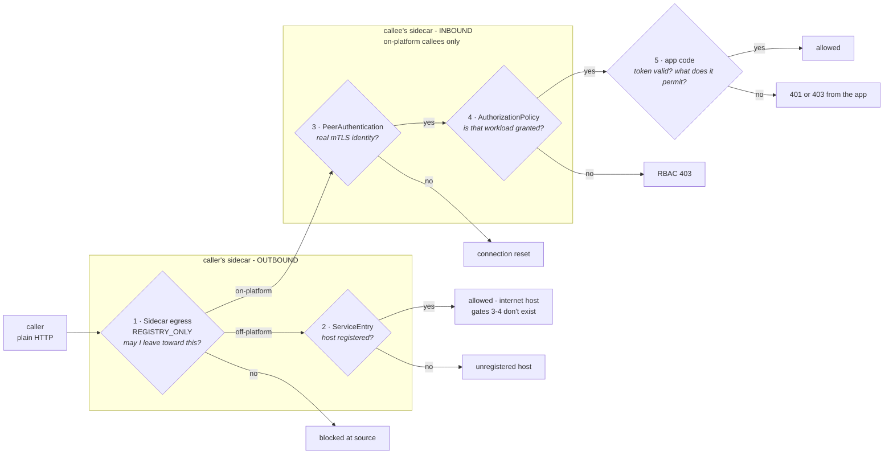

# Platform Connections

Kubernetes runs the workloads. The Istio service mesh decides which calls get through. It puts a proxy beside every pod, and every call in or out passes that proxy.

By default anything in a cluster can call anything else. Declaring each call means a breach stops at one app, and access is a line in git. A team asks the team it wants to call, not a central queue.

Live walkthrough at [connections.mattjarrett.dev](https://connections.mattjarrett.dev). What a team writes is in [App Configuration](./app-configuration.md).

## Requirements

1. Nothing is reachable without being declared. Same cluster or same namespace grants nothing.
2. The team that owns an interface decides who may call it.
3. Third-party egress is declared but not approved. It stays visible and can be shut off centrally.
4. Every workload has its own identity that cannot be forged or shared.
5. A refused call shows why. Nothing is silently allowed.
6. Apps never see Istio. No Istio kinds, SPIFFE strings or Envoy in any workspace file.

## What gets rendered

A call passes five gates: two leaving the caller, two arriving at the callee, one in the app. Each app's composition renders its own `Sidecar` and `AuthorizationPolicy` from its `consumes` and `provides`. Kyverno does admission checks, see [App Configuration → Admission checks](./app-configuration.md#admission-checks).



| Gates | Come from |
|---|---|
| 1 and 2 | The caller's `consumes` |
| 3 and 4 | The callee's `provides` |
| 5 | App code. The mesh never reads the Entra token. The app validates it and decides what `roles` or `scp` permits |

A field that already names a dependency declares it, so there are no double asks. A `Spa` `apiProxies` entry, or an `Api` binding a cache, needs nothing more.

The symptom tells you the gate.

| You see | Gate | Meaning |
|---|---|---|
| 502 through nginx | 1 | Destination missing from the caller's `Sidecar` egress, so its own proxy dropped it |
| Timeout to a public host | 2 | No `ServiceEntry`, so the host was never registered |
| Connection reset | 3 | Caller arrived in plaintext. Unmeshed, or its sidecar never started |
| RBAC 403 | 4 | Caller reached the callee and was refused by name. Not in `allowedCallers` |
| 401 or 403 from the app | 5 | Every mesh gate passed and the app refused the token. Missing, expired, wrong audience, or lacking the role |

Rules worth knowing.

| Rule | Detail |
|---|---|
| Registered is not permitted | A `ServiceEntry` tells Envoy a host exists. The `Sidecar` egress entry lets this workload send there. `REGISTRY_ONLY` needs both. A `ServiceEntry` is namespace-wide, so alone it would open every host to every app in the namespace |
| Policies attach to pods | Off-platform hosts have no gates 3 and 4. Neither do shared in-cluster stores without their own policy. A cache or database the platform composed has one, and only an Api that binds it gets in |
| Two unmeshed callers | Prometheus scrapes `/metrics` on the metrics port and nothing else. Traefik forwards ingress to the app port, only when a workload sets `host`. See [Known limits](#known-limits) |
| Proxied requests send the upstream's name as `Host` | Envoy routes on `:authority`. A browser hostname matches nothing, so `REGISTRY_ONLY` drops it. The `Spa` composition sets `Host` to the upstream and keeps the original as `X-Forwarded-Host` |
| WebSockets work | They open as HTTP/1.1 with an `Upgrade` header, so gates 1 to 4 apply as usual. An app that drops to raw TCP after the handshake falls under [Complications outside HTTP](#complications-outside-http) |

## The identity it rests on

Istio gives each meshed pod an X.509 certificate (an SVID) with a SPIFFE ID that cannot be faked.

```
spiffe://cluster.local/ns/team-b/sa/orders
         └ trust domain   └ namespace └ service account
```

| Fact | Detail |
|---|---|
| The principal | mTLS proves this string. Entra and AWS trust a separate SPIRE identity instead |
| Private key | Never leaves the pod, so knowing the name is not enough to claim it |
| One ServiceAccount per workload | Two apps sharing one are the same identity, and grants between them mean nothing |

[Platform Workload Identity](./workload-identity.md) covers rotation and federation.

## Known limits

The mesh controls calls between workloads. It does not control raw packets below it, or what a claim permits above it. Record-level access is out of scope.

| Limit | Detail |
|---|---|
| Governance, not containment | Istio enforces with iptables rules inside the pod. Code in that pod sits on the same side as the rules |
| UID 1337 bypasses Envoy | Istio skips that UID, because Envoy runs as it. Any process running as 1337 sends packets Envoy never sees |
| No node-level layer | Stopping that needs a CNI that enforces by identity and hostname. The cluster runs flannel, which does neither. This is not planned, because a compromised pod is outside the threat model |
| `NetworkPolicy` still works for coarse rules | The WordPress composition uses one to keep a site off the LAN. It names CIDRs, not hostnames |
| A `host` opens the app to unmeshed callers | Traefik has no mesh identity, so the routed port admits it. Meshed callers still need a grant. A `mattjarrett.dev` host reaches the internet. A `local.lab` host reaches the homelab network |
| Nothing tests that an app reaches its backend | Rendering is checked, behaviour is not. A workload can show `2/2`, sync green, and still fail every call to its API. This has caused one outage. Closing it is the most valuable work left |
| Long-lived apiserver watches break | The proxy cuts streaming watch connections |
| `Api` and `Spa` label pods differently | `app.kubernetes.io/instance` versus `instance`. A selector copied between them matches nothing. The policy renders, ArgoCD shows Synced, and nothing is enforced |
| Diagnosis takes work | A 403, an mTLS reset and blocked egress all look alike at first. Use the symptom table |

## Complications outside HTTP

- **UDP has no gates 3 and 4:** mTLS and `AuthorizationPolicy` need TCP and HTTP. Envoy passes UDP through with nothing to match. Syslog, RTP, telemetry collectors, DNS and QUIC all land here.
- **UDP gets no hostname:** Cloudflare Tunnel and Traefik carry HTTP or TCP only. Traefik does not listen on UDP.

## Reference

| Concept | Doc | Watch for |
|---|---|---|
| Sidecar injection | [injection](https://istio.io/latest/docs/setup/additional-setup/sidecar-injection/) | meshed pods show 2 containers |
| SPIFFE identity | [identity](https://istio.io/latest/docs/concepts/security/#istio-identity) | the principal string *is* the grant key |
| PeerAuthentication | [mutual TLS](https://istio.io/latest/docs/concepts/security/#peer-authentication) | STRICT has no dry-run |
| AuthorizationPolicy | [ref](https://istio.io/latest/docs/reference/config/security/authorization-policy/) | the first ALLOW makes that workload deny-by-default |
| ServiceEntry | [egress control](https://istio.io/latest/docs/tasks/traffic-management/egress/egress-control/) | registers a host. Alone it gates nothing |
| Sidecar + `REGISTRY_ONLY` | [ref](https://istio.io/latest/docs/reference/config/networking/sidecar/) | makes egress default-deny |
| NetworkPolicy | [ref](https://kubernetes.io/docs/concepts/services-networking/network-policies/) | CIDR rules only. The kubelet probe needs its own ingress rule |

> **Splitting a requirement widens it.** Istio ORs ALLOW policies and rules together, so two rules are two ways in. Anything that must all hold goes in one rule: `from` + `to` + `when`.
